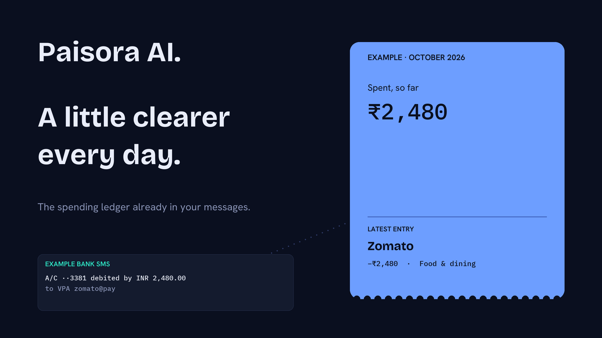

<p align="center">
  
</p>

<h1 align="center">Paisora AI</h1>

<p align="center">
  <strong>Your spending ledger, already in your messages.</strong><br>
  Turns bank SMS into a private ledger. Ask questions in plain English. Runs on your phone.
</p>

<p align="center">
  <a href="https://mahesh0843.github.io/paisora-landing/">
    
  </a>
  <a href="LICENSE">
    
  </a>
  
</p>

---

## What is Paisora AI?

Every bank sends an SMS for many transactions. Paisora AI parses supported bank messages and builds a personal spending ledger locally on your Android phone—without uploading raw SMS messages to a developer-operated server.

The optional AI Copilot lets you ask questions such as *“How much did I spend on food this month?”* The model translates your question into a structured query and helps phrase the result. Transaction filtering and arithmetic are performed locally by the app, not by the language model.

> **Not on Google Play yet.** Download the APK and setup guide from the [Paisora AI landing page](https://mahesh0843.github.io/paisora-landing/).

## Features

### 📩 Automatic SMS tracking
Reads supported bank SMS on-device, including formats from HDFC, SBI, and ICICI.

Examples of supported message patterns:
- **HDFC card UPI:** `Txn Rs.58.00 On HDFC Bank Card 7732 At merchant@ybl by UPI...`
- **HDFC P2P transfer:** `Sent Rs.1.00 From HDFC Bank A/C *2944 To ...`
- **Standard debit/credit:** `Rs.500 debited from A/c XX1234 at ZOMATO...`
- **Payment types:** NEFT, IMPS, RTGS, ATM, and card transactions, where the message format is supported.

Sender IDs are matched against an allowlist. The parser normalizes common two-letter routing prefixes such as `VM-`, `VK-`, `AD-`, `AX-`, and `JD-`.

### 🧠 Smart categorization
Rules-based merchant and keyword matching assigns transactions to 13 categories:

`Food & dining` · `Groceries` · `Travel` · `Bills` · `Shopping` · `Health` · `Entertainment` · `Transfers` · `EMI & loans` · `Salary` · `Investment` · `Cash withdrawal` · `Other`

Examples: Zomato → Food & dining, Uber → Travel, Bajaj Finance → EMI & loans, Vishal Mega Mart → Groceries.

### 🔍 Review inbox
Low-confidence parses are held in an Inbox so you can confirm, edit, or ignore them instead of silently accepting an uncertain transaction.

### 🔁 Recurring payment detection
Looks for recurring transactions such as subscriptions, rent, EMIs, salary, and SIPs using interval and amount consistency across multiple occurrences. Results are estimates and should be reviewed.

### 📊 Budgets and insights
- Monthly budgets by category with progress indicators
- Month-over-month spending trends
- Top merchants
- Flags for potentially unusual activity

### 🔐 PIN and biometric lock
- Six-digit PIN with optional fingerprint unlock
- Automatic lock after 30 seconds in the background
- PIN derivation/hash handling using the app's secure-storage implementation

### 🤖 AI Copilot
Ask questions about your own ledger in plain English:
- “How much did I spend on food this month?”
- “What was my biggest expense?”
- “Show all UPI transactions above ₹5,000.”

Choose your own API key from one of these providers:

| Provider | Best for |
| --- | --- |
| **Google Gemini** | General-purpose answers |
| **Groq** | Fast responses |
| **OpenRouter** | Access to multiple models |

Provider availability, rate limits, and free-tier terms can change. Check each provider's current terms. The Copilot is optional and off by default.

### 💾 Optional encrypted backup
The optional backup service uses an encrypted payload model. The recovery secret is intended to let only the user decrypt their backup; the server should store ciphertext rather than readable ledger data. Review the implementation and threat model before relying on it for critical data.

## Privacy

Privacy is a core design goal:

- **Local parsing:** raw SMS messages are parsed on the device.
- **No app account required:** the app is designed to work without a developer-operated user account or analytics tracking.
- **AI provider calls are optional:** when you use the Copilot, selected transaction fields may be sent directly to the AI provider you configured. Raw SMS, account numbers, and unrelated personal messages should not be included.
- **API key storage:** provider keys are stored using `expo-secure-store` on Android.
- **Delete controls:** use the in-app data deletion controls to clear local app data.
- **Optional backup:** backup data is encrypted before upload.

The ledger, parser, budgets, and other local features are intended to work offline. The AI Copilot and remote backup require network access. Review the app's current implementation and provider privacy policies before entering sensitive information.

## Screenshots

| Home | AI Copilot | Insights | Budgets |
| :---: | :---: | :---: | :---: |
| `screens/home.png` | `screens/copilot.png` | `screens/insights.png` | `screens/budgets.png` |

Screenshots are planned. See the [landing page](https://mahesh0843.github.io/paisora-landing/) for previews.

## Install

### Install the APK

1. Visit the [Paisora AI landing page](https://mahesh0843.github.io/paisora-landing/).
2. Download the APK.
3. If Android asks, allow installation from the source you used to download it.
4. Open Paisora AI and grant SMS permission if you want automatic SMS import.
5. Configure the supported bank sender IDs, then tap **Read my bank SMS**.

Only install APKs you trust. Android may show additional security prompts for apps installed outside Google Play.

### Run from source

Requirements: **Node.js 22.13+**, **npm**, **Git**, and the **Android SDK** for native Android builds.

```bash
git clone https://github.com/Mahesh0843/Paisora-AI.git
cd Paisora-AI/mobile
npm ci
cp .env.example .env
npm start
```

For an Android development build, connect an Android device or start an emulator, then run:

```bash
npx expo run:android
```

Paisora AI uses a custom native Kotlin Expo module for SMS access, so **Expo Go is not sufficient**. Use a development build or EAS Build.

### Build an APK with EAS

```bash
cd mobile
eas build --platform android --profile preview
```

The preview profile is intended to produce an installable APK when configured accordingly. The production profile may produce an Android App Bundle (`.aab`) for Play Store submission.

### Configure the AI Copilot

1. Create an API key with [Google Gemini](https://ai.google.dev/), [Groq](https://console.groq.com/), or [OpenRouter](https://openrouter.ai/).
2. Open **You → AI provider** in the app and enter the key.
3. Tap **Test connection**.
4. Open **You → Ask about your money** and ask a question.

The app calls the selected AI provider directly; the key is not intended to pass through a server operated by the Paisora AI developer. Review the configured provider's privacy and retention policies.

## Architecture

The architecture diagram is maintained as [`arr.svg`](arr.svg). GitHub displays SVG files directly, and the diagram can also be opened separately.


### Key design decisions

- **Deterministic arithmetic:** the LLM translates natural-language questions into structured intent and helps phrase results. The local query engine calculates totals and filters transactions.
- **Graceful fallback:** AI calls should fall back to a local template when the provider is unavailable, rate-limited, or disabled.
- **Raw SMS stays local:** raw SMS content is stored locally and should not be included in cloud backups or AI prompts.
- **Sender allowlists:** SMS sender IDs are checked against configured allowlists rather than relying only on message-body matching.
- **Optional network features:** AI requests and remote backup need connectivity; core ledger features are designed for offline use.

## Repository layout

```text
Paisora-AI/
├── mobile/                         # React Native + Expo app
│   ├── src/
│   │   ├── app/                    # Screens and Expo Router routes
│   │   │   ├── (tabs)/             # Home, inbox, insights, budgets, you
│   │   │   ├── ai-settings.tsx     # AI provider and API key setup
│   │   │   ├── copilot.tsx          # AI chat interface
│   │   │   ├── lock.tsx             # PIN and biometric unlock
│   │   │   ├── recurring.tsx        # Recurring payment view
│   │   │   └── _layout.tsx          # Root layout and lock gate
│   │   ├── components/             # Reusable UI components
│   │   ├── lib/
│   │   │   ├── parser.ts            # SMS parsing and categorization
│   │   │   ├── database.ts          # Local SQLite operations
│   │   │   ├── auth.ts              # PIN and biometric logic
│   │   │   ├── llm.ts               # AI orchestration and safeguards
│   │   │   ├── copilot.ts           # Intent extraction and query engine
│   │   │   ├── providers.ts         # Gemini, Groq, OpenRouter adapters
│   │   │   ├── recurring.ts         # Recurring transaction detection
│   │   │   └── backup.ts            # Encrypted backup logic
│   │   ├── state/                  # App state and ledger provider
│   │   ├── ui/                     # Theme, icons, forms, design system
│   │   └── types/                  # TypeScript types
│   ├── modules/kharcha-sms/        # Native Kotlin SMS module
│   ├── android/                    # Native Android project
│   └── tests/                      # Parser and recurring tests
├── api/                            # Optional encrypted-backup server
├── docs/brand/                     # Brand assets and cover generator
├── arr.svg                         # Architecture diagram
├── LICENSE
└── README.md
```

> File names may differ as the project evolves; keep this tree aligned with the repository.

## Development

Run the checks from the `mobile` directory:

```bash
npx tsc --noEmit
npm test
```

If you modify native Kotlin code under `mobile/modules/kharcha-sms/android/`, rebuild the native app:

```bash
npx expo run:android
```

A Metro refresh alone does not rebuild native code.

## Tech stack

| Layer | Technology |
| --- | --- |
| App | React Native, Expo, TypeScript |
| Navigation | Expo Router |
| State | React Context (`LedgerProvider`) |
| Local database | `expo-sqlite` |
| Secure storage | `expo-secure-store` |
| Biometrics | `expo-local-authentication` |
| Native SMS access | Custom Kotlin Expo module |
| AI providers | Gemini, Groq, OpenRouter |
| Optional backup | Node.js and PostgreSQL (if enabled) |

## Distribution notes

Paisora AI is currently distributed through a direct APK download. Google Play restricts SMS and Call Log permissions and requires apps to qualify under its policy and complete the applicable declaration and review process. Approval is not guaranteed. Check the current [Google Play SMS and Call Log permissions policy](https://support.google.com/googleplay/android-developer/answer/10208820) before submission.

iOS does not provide a general public API for third-party apps to read a user's SMS inbox. An iOS version would need a different import flow, such as manual entry or paste-SMS.

## Roadmap

- [x] SMS parsing for supported HDFC, SBI, and ICICI formats
- [x] Manual entry and paste-SMS
- [x] 13 rules-based categories
- [x] Review inbox for uncertain parses
- [x] PIN and biometric lock
- [x] AI Copilot with provider selection
- [x] Recurring payment detection
- [x] Monthly budgets
- [x] Encrypted backup
- [ ] Anomaly detection
- [ ] Monthly AI report
- [ ] Transaction explanations
- [ ] CSV and PDF export
- [ ] More bank formats: Axis, Kotak, PNB, Bank of Baroda, Canara
- [ ] Google Play submission

## Credits

Paisora AI is derived from **Kharcha** by [@cneuralnetwork](https://github.com/cneuralnetwork), used under the MIT License.

Substantial changes in Paisora AI include:
- Rebranding and new visual identity
- Android package rename from `dev.kharcha.app` to `dev.paisora.ai`
- AI Copilot integration for Gemini, Groq, and OpenRouter
- AI provider selection and secure key storage
- PIN and biometric app lock
- Recurring payment detection
- Support for additional HDFC SMS formats
- Expansion from 8 to 13 transaction categories
- Dedicated landing page

The original Kharcha project, its README, and architecture deserve credit for the foundation. Please retain the upstream copyright and license notices.

## Disclaimer

Paisora AI is an expense organizer, not a bank statement, tax record, or financial-advice service. It may miss or misparse messages, and AI wording may be imperfect. It is not affiliated with any bank. Always use your bank's records as the source of truth.

## License

MIT License. See [`LICENSE`](LICENSE).

Original work © 2025 cneuralnetwork (Kharcha).  
Modifications © 2026 Singuluri Mahesh Chandra (Paisora AI).

Expo, React Native, and other dependencies retain their respective licenses.
